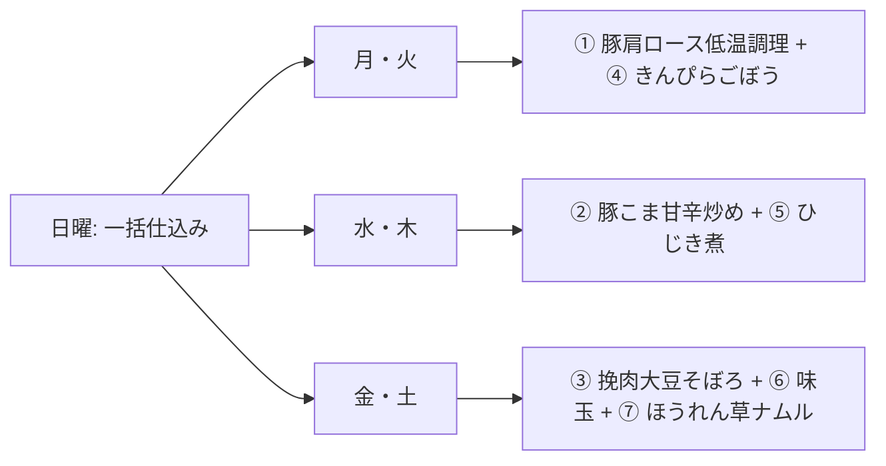

# 週間作り置きレシピ

材料は各レシピで使い切る分量にしています。各項目は [schema.org/Recipe](https://schema.org/Recipe) の主要フィールド(`recipeYield` / `prepTime` / `cookTime` / `recipeIngredient` / `recipeInstructions`)に準拠して記載しています。

## 週間ローテーション

汁物は各自で液味噌を溶いて対応するため、ここには含めません。

---

## メインおかず

### ① 豚肩ロースの低温調理

- **recipeYield**: 作り置き4食分
- **prepTime**: PT10M
- **cookTime**: PT1H
- **調理器具**: 低温調理器（汎用モデル）
- **recipeIngredient**:
  - 豚肩ロースブロック 1本(約400g)
  - 塩コショウ 少々
  - 香味ペースト 大さじ1
- **recipeInstructions**:
  1. 豚肩ロースブロックに塩コショウと香味ペーストをすり込む。
  2. 真空保存袋または密閉袋に入れ、空気を抜く。
  3. 63℃・1時間、低温調理器で加熱する。
  4. 粗熱を取り、スライスして保存容器へ。
- **保存目安**: 冷蔵4日、冷凍可

### ② 豚こま肉と野菜の甘辛炒め

- **recipeYield**: 作り置き3〜4食分
- **prepTime**: PT10M
- **cookTime**: PT10M
- **調理器具**: 深型フライパン（汎用サイズ）、肉切りハサミ
- **recipeIngredient**:
  - 豚こま切れ肉 1パック(約300g)
  - ピーマン 1袋
  - にんじん 1本
  - 醤油 大さじ2
  - みりん 大さじ2
  - 砂糖 大さじ1
  - 料理酒 大さじ1
- **recipeInstructions**:
  1. 豚こま肉は肉切りハサミで一口大にカットしながらフライパンへ。
  2. ピーマン・にんじんを細切りにし加える。
  3. 中火で炒め、火が通ったら醤油・みりん・砂糖・料理酒を加えて煮絡める。
- **保存目安**: 冷蔵3〜4日、冷凍可

### ③ 合い挽き肉と大豆のスパイシーそぼろ

- **recipeYield**: 作り置き4食分
- **prepTime**: PT10M
- **cookTime**: PT25M
- **調理器具**: ホットクック（汎用容量）、フードプロセッサー(玉ねぎみじん切り用)
- **recipeIngredient**:
  - 合い挽き肉 300g
  - 蒸し大豆 1袋
  - 玉ねぎ 1個
  - カレー粉 小さじ2
  - 味噌 大さじ1
  - 豆板醤 小さじ1
  - 料理酒 大さじ2
- **recipeInstructions**:
  1. 玉ねぎをフードプロセッサーでみじん切りにする。
  2. ホットクックの内鍋に全材料を入れる。
  3. 「炒め物」または「手動調理」メニューで加熱・撹拌する。
- **保存目安**: 冷蔵4日、冷凍可

---

## 副菜

### ④ きんぴらごぼう

- **recipeYield**: 作り置き4〜5食分
- **prepTime**: PT10M
- **cookTime**: PT10M
- **調理器具**: 片手鍋（汎用容量）、または深型フライパン
- **recipeIngredient**:
  - ごぼう 1袋
  - にんじん 1本
  - ごま油 大さじ1
  - 醤油 大さじ1.5
  - みりん 大さじ1.5
  - 砂糖 大さじ1
- **recipeInstructions**:
  1. ごぼう・にんじんを千切りにする。
  2. ごま油で炒め、しんなりしたら調味料を加えて煮絡める。
- **保存目安**: 冷蔵5日

### ⑤ ひじきの煮物

- **recipeYield**: 作り置き4〜5食分
- **prepTime**: PT15M(戻し時間含む)
- **cookTime**: PT15M
- **調理器具**: 片手鍋1.5L
- **recipeIngredient**:
  - 乾燥ひじき 1袋
  - 油揚げ 1枚
  - にんじん 半端分
  - 醤油 大さじ2
  - みりん 大さじ2
  - ほんだし 小さじ1
- **recipeInstructions**:
  1. ひじきを水で戻し、水気を切る。
  2. 油揚げは油抜きして細切り、にんじんは短冊切り。
  3. 鍋に全材料と水150mlを入れ、汁気が少なくなるまで煮る。
- **保存目安**: 冷蔵5日、冷凍可

### ⑥ 味玉(半熟卵の醤油漬け)

- **recipeYield**: 卵1パック分
- **prepTime**: PT5M
- **cookTime**: PT7M(+ 漬け込み6時間以上)
- **recipeIngredient**:
  - 卵 1パック
  - 醤油 100ml
  - みりん 100ml
  - 水 200ml
- **recipeInstructions**:
  1. 卵を沸騰湯で6〜7分茹で、冷水で殻をむく。
  2. 醤油・みりん・水を混ぜたタレに卵を漬ける。
  3. 冷蔵庫で半日〜1晩置く。
- **保存目安**: 冷蔵4〜5日

### ⑦ ほうれん草のナムル

- **recipeYield**: 作り置き3〜4食分
- **prepTime**: PT10M
- **cookTime**: PT2M
- **recipeIngredient**:
  - ほうれん草 1袋
  - ごま油 大さじ1
  - 塩 小さじ1/2
  - にんにく(チューブ可) 小さじ1/2
- **recipeInstructions**:
  1. ほうれん草を熱湯でさっと茹で、冷水にとり水気を絞る。
  2. 食べやすい長さに切り、ごま油・塩・にんにくで和える。
- **保存目安**: 冷蔵3〜4日
